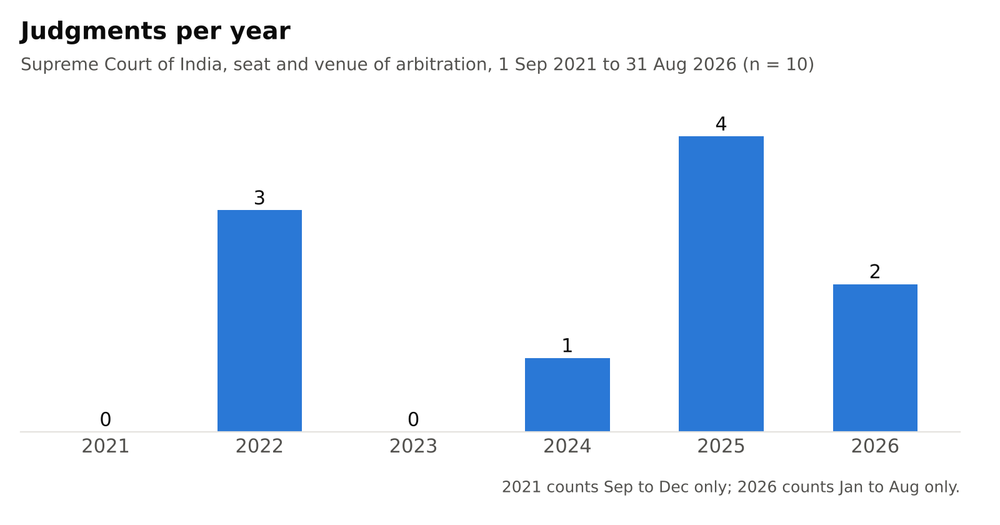
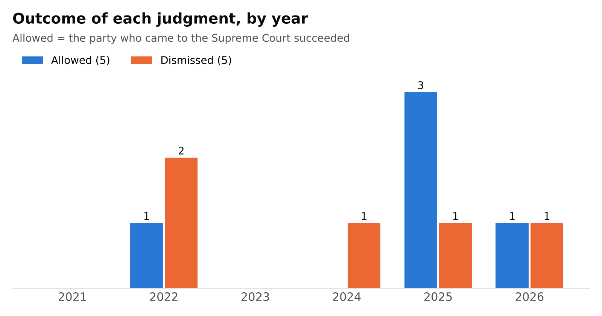
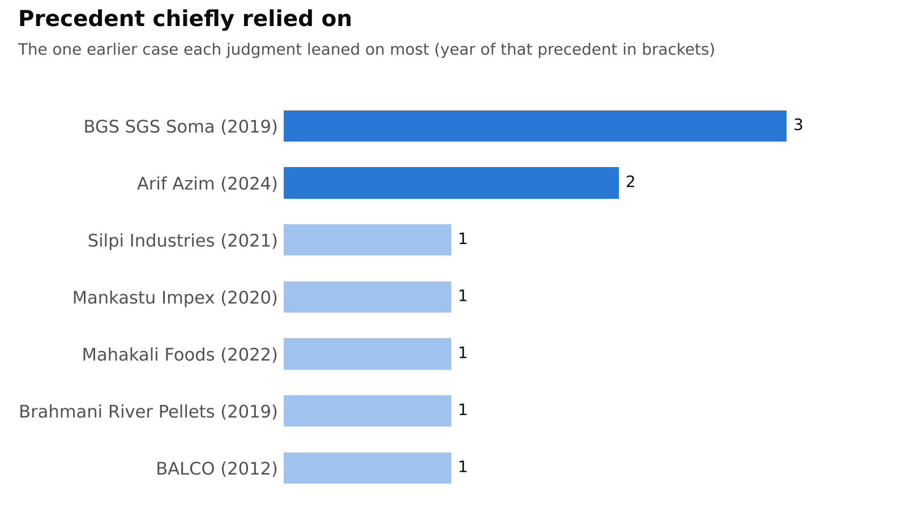

# Seat and venue of arbitration in the Supreme Court of India, 2021 to 2026

Analysis page: https://ishtarthh.github.io/arbitration-seat-judgments/ · Data: [data.csv](data.csv) and [data.xlsx](data.xlsx)

## Team

Team Seat and Venue

- Ishtarth H R, Division D

## Topic

Every arbitration has a legal home, its "seat", and the courts of the seat supervise it: they appoint arbitrators, hear challenges to the award and grant interim relief. Parties often write "venue", "place" or "sittings" instead, or name two cities, so courts must work out which place is the seat and which is only a meeting place. We chose this topic because it decides which court a commercial client must go to, and because the Supreme Court has kept refining the test since BGS SGS Soma (2019).

## How we found the judgments

We searched for Supreme Court decisions dated 1 September 2021 to 31 August 2026 using the terms "seat of arbitration", "venue", "juridical seat", "place of arbitration" and "exclusive jurisdiction" with "arbitration". We searched Indian Kanoon, the Supreme Court's judgment pages and the yearly arbitration digests of LiveLaw, Verdictum, SCC Online and Supreme Court Observer. This gave about 20 candidate decisions.

We kept reasoned judgments and reasoned orders that decide where an arbitration is seated, or which court or forum controls it because of the seat. We left out decisions outside the window (Inox Renewables and PASL Wind, both April 2021; Mahanadi Coalfields, September 2026; ARCIS Clean Energy, October 2026), an SLP dismissed without reasons (Sliksync, July 2026) and cases on other jurisdiction questions such as section 29A extensions and limitation. Ten judgments remained. Eight source links point to the Supreme Court's own copies. For BBR (India) and Bhartia Infra we could not find the official file, so those link to Indian Kanoon.

## What the data shows

**Judgments per year.** Three judgments in our set fall in 2022, none in 2023, one in 2024, four in 2025 and two in the first eight months of 2026. The rise follows Arif Azim v. Micromax (November 2024), a three-judge decision that restated the test. Six of the ten judgments came after it. We were surprised to find no reasoned seat judgment at all in 2023.

**Outcomes.** Five appeals or petitions were allowed and five dismissed. The split holds even in the three international cases filed directly in the Supreme Court: Arif Azim (Dubai seat) and Balaji Steel (Benin seat) failed, while Disortho (Indian seat) succeeded. The Court does not lean towards keeping disputes in India or towards the appellant. The answer follows the clause. We expected outcomes to favour whoever argued for an Indian seat, and that did not happen.

**Precedent chiefly relied on.** BGS SGS Soma is the case the Court leaned on most (three judgments). Arif Azim, itself built on BGS Soma, is already the main authority in two later judgments, Disortho (2025) and Bhartia Infra (2026). Over the period the method moved from policing the words "seat" and "venue" (Ravi Ranjan and BBR, 2022) to reading the whole agreement, including governing law and exclusive jurisdiction clauses (Activitas 2025, Bhartia 2026). The one exception to party choice is the MSMED Act: in Mahakali Foods and Harcharan Dass Gupta the statute overrode the agreed forum. We did not expect exclusive jurisdiction clauses to do so much work in deciding the seat.

## Limits

Ten judgments are too few for trends in the statistical sense. A reader should not treat a count of four in 2025 as a measure of litigation volume, or the 5 to 5 split as a rule. The set also misses seat questions decided by High Courts and orders without reasons, and our search may have missed a judgment that does not use our search terms.

## AI-use disclosure

We used Claude (Anthropic) to run the database searches, shortlist candidates, draft the one-line issue and holding entries from the official copies, and build the charts, the analysis page and a first draft of this README. The team member named in the "Coded by" column then checked every row against the judgment linked in the Source column: the date, bench, case number, outcome, provision, precedent and the issue and holding lines. Where the AI output and the judgment differed, we followed the judgment.
